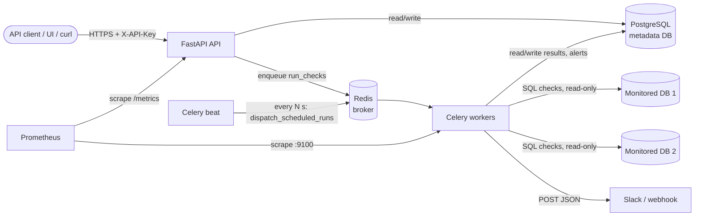
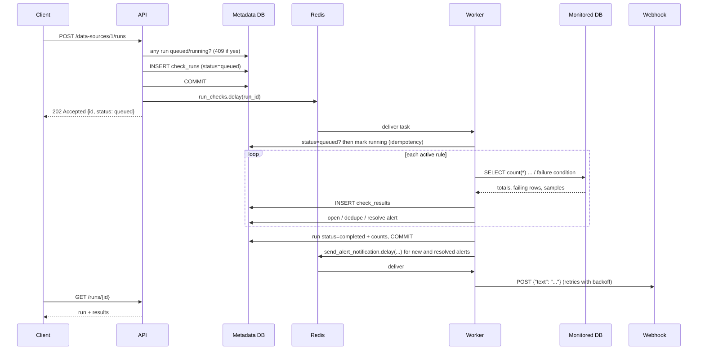
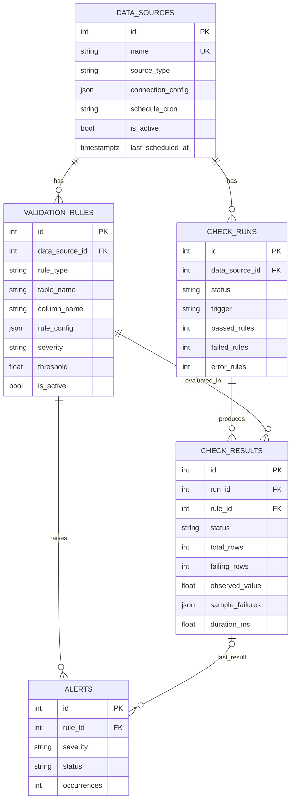

# DQ Monitor: Architecture

## 1. System context

There are three kinds of process, all built from **one Docker image**:

| Process | Role | Scales by |
|---|---|---|
| **API** (uvicorn + FastAPI) | CRUD for sources and rules, triggers runs, reads results | More replicas behind a load balancer (stateless) |
| **Worker** (Celery) | Executes checks against monitored DBs, records results, manages alerts, sends notifications | More workers or higher `--concurrency` |
| **Beat** (Celery beat) | Clock: every tick, asks "which sources are due?" | Exactly one instance |

The **metadata DB** (PostgreSQL) is the system of record. **Redis** only carries messages.
If Redis loses a message, the run row still exists with status `queued`, so it is visible
and can be re-triggered.

## 2. Request flow: triggering a run

**Why commit before enqueue?** If the task were enqueued first, a fast worker could pick it
up before the API's transaction commits. The worker would then find no run row.

## 3. Data model

Status values:

- `check_runs.status`: `queued → running → completed | failed`
- `check_results.status`: `passed | failed | error`. `error` means the check could not run,
  for example a missing column or an unreachable database.
- `alerts.status`: `open → acknowledged → resolved`

Foreign keys use `ON DELETE CASCADE`: deleting a source removes its rules, runs, results and
alerts. Columns used in filters (`status`, `data_source_id`, `rule_id`) are indexed.

## 4. The check engine (`app/engine/checks.py`)

Each check type is a small class registered in `CHECKS`. Most share one pattern
(`RowLevelCheck`): *count all rows, count rows matching a failure condition, then compare
the ratio with the threshold.*

| rule_type | Failure condition (SQL) | Config |
|---|---|---|
| `not_null` | `col IS NULL` | none |
| `range` | `col < min OR col > max` | `min`, `max` |
| `accepted_values` | `col NOT IN (...)` | `values` |
| `regex` | `NOT col ~ pattern` | `pattern` |
| `unique` | `count(col) - count(DISTINCT col)` | none |
| `row_count` | `count(*)` outside `[min, max]` | `min`, `max` |
| `freshness` | `now() - max(col) > max_age` | `max_age_minutes` |
| `custom_sql` | the query returns any rows | `sql` |

**Pushdown:** the database does the counting. A 100M-row table costs DQ Monitor two
`count(*)` queries, not 100M rows over the network.

**Safety layers:**

1. Table and column names must match `^[A-Za-z_][A-Za-z0-9_]*$`. They are validated when
   the rule is created *and* again when it runs.
2. Queries are built with SQLAlchemy Core, so identifiers are quoted per dialect and values
   are bound parameters. There is no string concatenation of user input.
3. `custom_sql` must be a single `SELECT`/`WITH` statement with no DDL or DML keywords. On
   Postgres it runs in `SET TRANSACTION READ ONLY`.
4. Every check connection is rolled back, never committed.
5. Postgres connections get `statement_timeout` so a runaway query is cancelled.
6. Recommended: a read-only DB user per source.

Adding a check type takes one subclass and one entry in the registry. The API, validation
and `/rules/types` pick it up automatically.

## 5. Reliability design

| Concern | How it's handled |
|---|---|
| Worker crashes mid-run | `task_acks_late` + `reject_on_worker_lost`: the broker redelivers the task |
| Duplicate task delivery | Runner only executes runs in `queued`; a second delivery is a no-op |
| One rule breaks | Caught per rule and recorded as `error`; the other rules still run |
| Overlapping scheduled runs | The scheduler skips a source with a run still `queued`/`running` |
| Multiple schedulers | `SELECT ... FOR UPDATE SKIP LOCKED` on the source rows |
| Webhook down | Notification task retries 5x with exponential backoff and jitter |
| Alert storms | One active alert per rule; repeats increment `occurrences` |
| Slow source | `statement_timeout`; worker concurrency isolates sources |
| Stale DB connections | `pool_pre_ping` + `pool_recycle` |

## 6. Observability

- **Logs:** one JSON object per line, with `request_id` on API logs. Clients may send
  `X-Request-ID` and it is echoed back.
- **Metrics** (Prometheus):
  - `dq_http_requests_total{method,route,status}`, `dq_http_request_duration_seconds`
  - `dq_check_results_total{rule_type,status}`, `dq_check_duration_seconds{rule_type}`
  - `dq_runs_total{status,trigger}`, `dq_alerts_opened_total{severity}`,
    `dq_notifications_total{outcome}`
  - HTTP metrics are labelled by the route *template* (`/runs/{run_id}`), which keeps label
    cardinality bounded.
- **Probes:** `/health` (process alive) and `/ready` (DB reachable, else 503). This matches
  Kubernetes liveness and readiness semantics.

## 7. Configuration and environments

All settings live in `app/config.py` and are read from environment variables.

| Environment | Metadata DB | Execution |
|---|---|---|
| Local dev | SQLite file | Celery eager mode: tasks run inline, no Redis |
| Tests | Temp SQLite | Eager mode, so assertions run right after the HTTP call |
| Docker / prod | PostgreSQL | Real Celery workers + Redis broker |

Code paths stay the same in every environment. Only the configuration changes.

## 8. Trade-offs and future work

- **API-key auth** is simple and fits service-to-service use. Multi-user access would need
  OAuth2/JWT with per-team scoping.
- **Connection URLs are stored in plain JSON.** Production should encrypt them, for example
  with Fernet or a KMS, or reference a secrets manager.
- **Synchronous SQLAlchemy** in FastAPI routes: each request runs in FastAPI's threadpool.
  That is simpler than async SQLAlchemy and fine at this scale, because the heavy work
  happens on workers.
- **Result retention**: results grow without limit. A periodic purge task or monthly table
  partitions would cap that.
- **More connectors**: Snowflake, BigQuery and MySQL need only a SQLAlchemy dialect and an
  entry in `SUPPORTED_SOURCE_TYPES`.
- **Anomaly detection**: `observed_value` history per rule already supports
  z-score/seasonal checks (for example, "row count dropped 40% vs. 7-day average").
